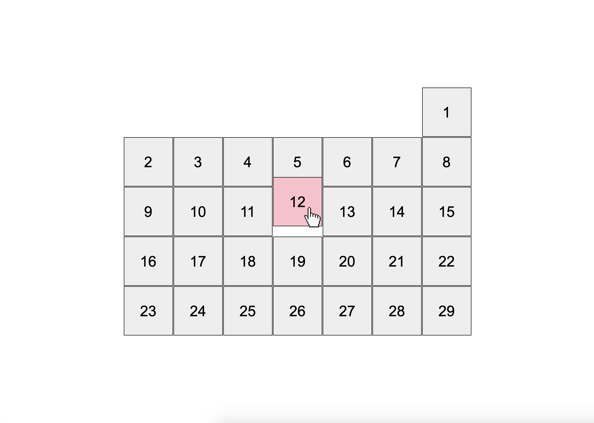

# Calendar

Display a calendar in the middle of the screen (both horizontally and vertically). Use SCSS and follow BEM. Don't use Javascript.

- Write styles in `src/styles/main.scss` instead of `src/style.css`.
- Create a markup for the calendar block with 31 days inside
  - DON'T add numbers in HTML (you will do it using CSS)
- Each day is a grey (`#eee`) `100px` square (including 1px black border)
  - Add a number (`Arial 30px`) in the center of each day using `::before` and [@for](https://sass-lang.com/documentation/at-rules/control/for)
- Use flex with `1px` gap and limit its width to exactly 7 columns + `10px` paddings
  - Don't use hardcoded `px` values if they are used several times
  - Use properly named variables to make all the calculations more clear.
- Implement `start-day` modifier for the `calendar` with `mon`, `tue`, `wed`, `thu`, `fri`, `sat` and `sun` values
  - Use [@each](https://sass-lang.com/documentation/at-rules/control/each) to create all the modifiers
  - The month should start at the correct column (Monday is the 1st, Friday is the 5th)
  - You can just add correct `margin-left` for the first day
  - Set calendar to start from Sunday by default in your HTML
- Add a modifier `month-length` for the `calendar` with values 28, 29, 30 and 31 (use `@for`)
  - It sets the last day to show (use [nth-child](https://css-tricks.com/how-nth-child-works/))
  - Set 31 days by default in your HTML

On hovering over a cell:
- cursor should become pointer
- The hovered cell has to become pink (use `#FFBFCB`)
- Move the hovered cell up by `20px` (use `transform`)
- All changes should be animated with the duration of 0.5s

> Here are the [Layout Tasks Instructions](https://mate-academy.github.io/layout_task-guideline)

*Important note*: In this task, you are allowed to link `*.scss` files directly in HTML `<link>` tags using `href` attribute.
This is possible because [we use the Parcel library](https://en.parceljs.org/scss.html) to bundle your solution's source code.

.

## Checklist

❗️ Replace `<your_account>` with your Github username and copy the links to `Pull Request` description:

- [DEMO LINK](https://lightdiller.github.io/layout_calendar/)
- [TEST REPORT LINK](https://lightdiller.github.io/layout_calendar/report/html_report/)

❗️ Copy this `Checklist` to the `Pull Request` description after links, and put `- [x]` before each point after you checked it.

- [ ] Changing 'month-lengh' and 'start-day' modifier in the code element
reflects in changing calendar layout
- [ ] Each day has no modifiers, only class (eg. calendar__day)
- [ ] All `Typical Mistakes` from `BEM` lesson theory are checked.
- [ ] Code follows all the [Code Style Rules ❗️](https://mate-academy.github.io/layout_task-guideline/html-css-code-style-rules)

Отобразите календарь по центру экрана (как по горизонтали, так и по вертикали). Используйте SCSS и следуйте методологии BEM. Javascript использовать нельзя.

Требования:
Пишите стили в src/styles/main.scss, а не в src/style.css.
Создайте разметку блока календаря с 31 днём внутри
НЕ добавляйте числа в HTML (вы сделаете это с помощью CSS)
Дни календаря:
Каждый день — это серый (#eee) квадрат размером 100px (включая чёрную границу 1px)
Добавьте номер дня (Arial, 30px) по центру каждого дня, используя ::before и
@for: https://sass-lang.com/documentation/at-rules/control/for
Сетка:
Используйте flex с отступом 1px между элементами
Ограничьте ширину ровно до 7 колонок + паддинги по 10px
Не используйте захардкоженные px, если они повторяются
Используйте переменные с понятными именами для расчётов
Модификатор start-day:
Реализуйте модификатор calendar с вариантами:
mon, tue, wed, thu, fri, sat, sun
Используйте @each: https://sass-lang.com/documentation/at-rules/control/each
Месяц должен начинаться с правильной колонки
(понедельник — 1-я, пятница — 5-я)
Можно просто задать правильный margin-left для первого дня
По умолчанию календарь должен начинаться с воскресенья (в HTML)
Модификатор month-length:
Реализуйте модификатор с вариантами: 28, 29, 30, 31
Используйте @for
Он задаёт последний отображаемый день (используйте nth-child:
https://css-tricks.com/how-nth-child-works/
)
По умолчанию — 31 день (в HTML)
Hover-эффекты:

При наведении на ячейку:

Курсор становится pointer
Ячейка становится розовой (#FFBFCB)
Ячейка поднимается вверх на 20px (transform)
Все изменения должны анимироваться с длительностью 0.5s

📌 Инструкция по заданию:
https://mate-academy.github.io/layout_task-guideline

Важно:

В этом задании можно подключать *.scss напрямую в HTML через <link href="">,
так как используется сборщик Parcel, который обрабатывает SCSS.

Отобразите календарь по центру экрана (как по горизонтали, так и по вертикали). Используйте SCSS и придерживайтесь методологии BEM. Не используйте JavaScript.

Пишите стили в src/styles/main.scss вместо src/style.css.
Создайте разметку для блока календаря с 31 днём внутри.
НЕ добавляйте числа в HTML (вы сделаете это с помощью CSS).
Каждый день — это серый (#eee) квадрат размером 100px (включая чёрную рамку 1px).
Добавьте номер (шрифт Arial, 30px) по центру каждого дня с помощью ::before и @for.
Используйте flex с отступом (gap) 1px и ограничьте ширину ровно до 7 колонок + 10px внутренних отступов (padding).
Не используйте захардкоженные значения px, если они повторяются несколько раз.
Используйте осмысленно названные переменные, чтобы сделать расчёты более понятными.
Реализуйте модификатор start-day для календаря со значениями mon, tue, wed, thu, fri, sat и sun.
Используйте @each, чтобы создать все модификаторы.
Месяц должен начинаться с правильной колонки (понедельник — 1-я, пятница — 5-я).
Можно просто задать margin-left для первого дня.
По умолчанию установите начало календаря с воскресенья в HTML.
Добавьте модификатор month-length для календаря со значениями 28, 29, 30 и 31 (используйте @for).
Он должен задавать последний отображаемый день (используйте nth-child).
По умолчанию в HTML должно быть 31 день.
При наведении на ячейку:
курсор должен становиться pointer
ячейка должна становиться розовой (используйте #FFBFCB)
ячейка должна подниматься вверх на 20px (используйте transform)
все изменения должны быть анимированы с длительностью 0.5s
